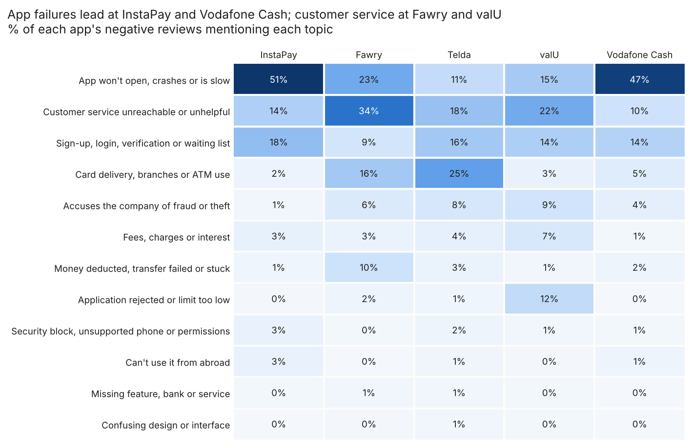
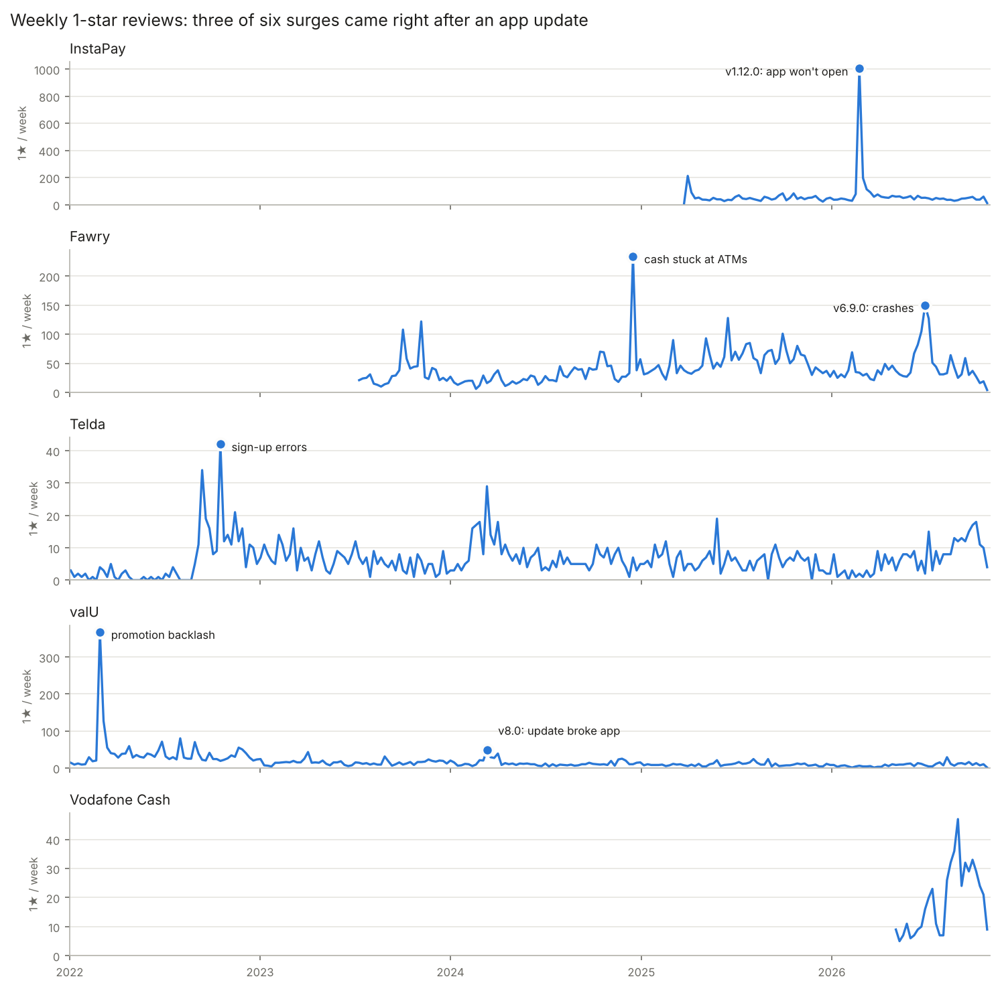
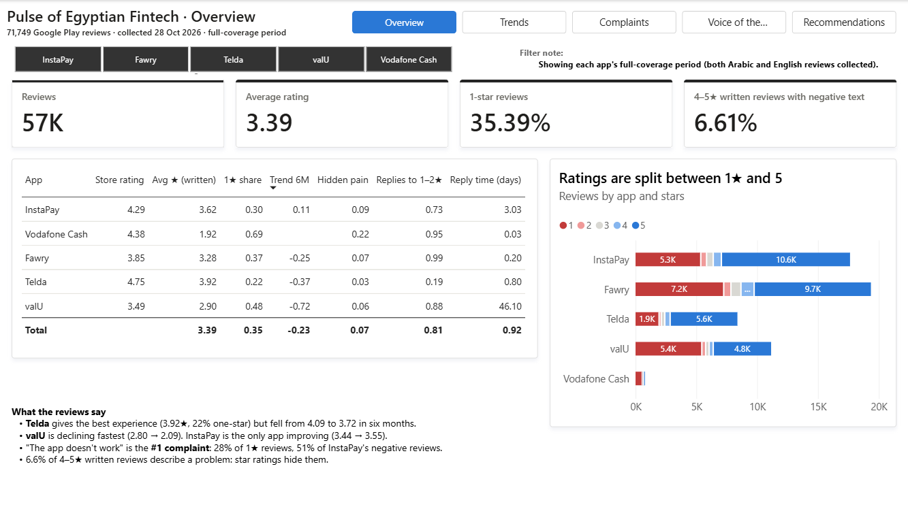
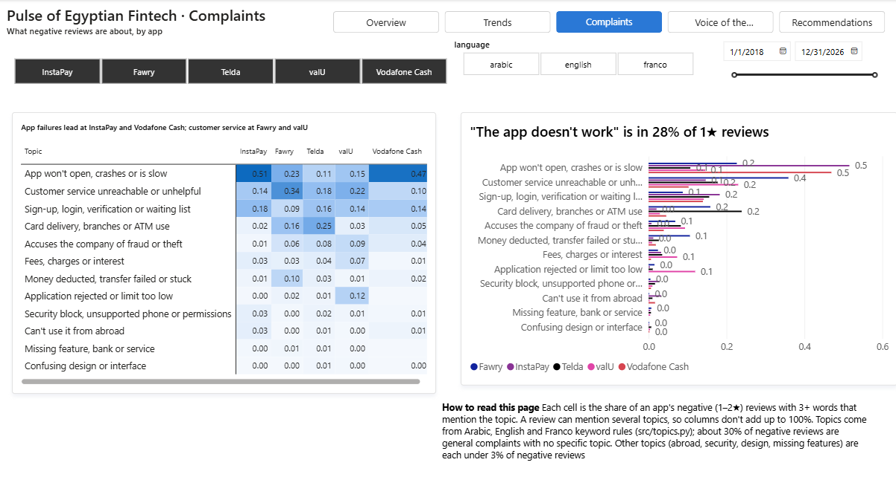
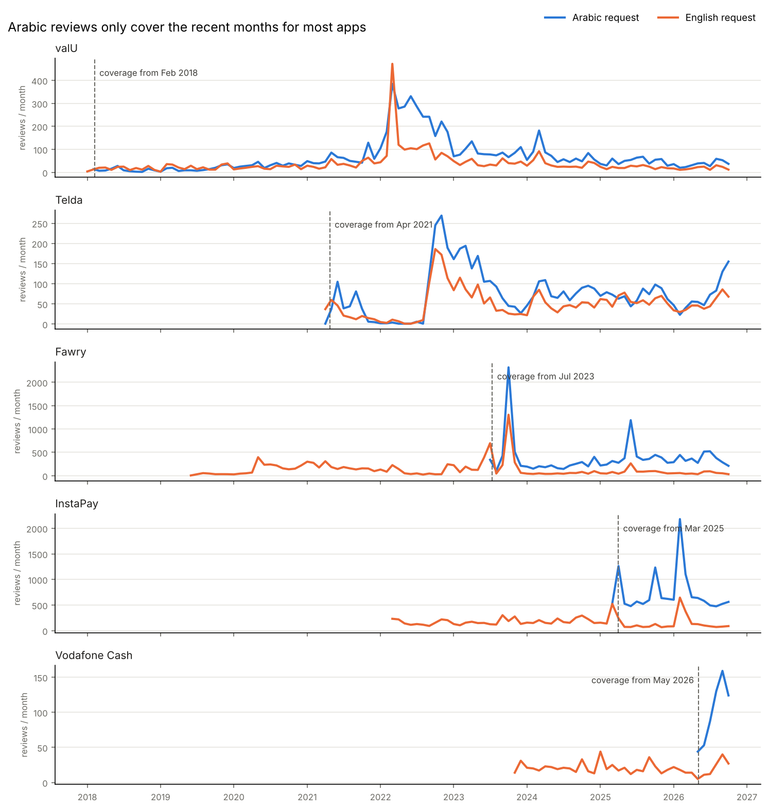

# Pulse of Egyptian Fintech
### What Egyptian users really think about fintech apps

An analysis of real Google Play reviews of five Egyptian fintech apps: **InstaPay, Vodafone Cash, Telda, valU and Fawry**. The project finds what frustrates users most, when ratings dropped and why, and which app gives the best experience, across Arabic, English and Franco-Arabic reviews.

> Status: analysis complete (notebooks 01–05) and Power BI dashboard built (`dashboard/pulse_of_egyptian_fintech.pbix`). Screenshots and a PDF export are below.

---

## Key findings
*(Each app is measured over its full-coverage period; see notebooks 02–05.)*

1. **Updates cause the worst weeks.** Three of six complaint surges came right after an update that stopped the app from opening: InstaPay 1.12.0, Fawry 6.9.0 and valU 8.0.x.
2. **InstaPay 1.12.0 (Feb 2026) is the biggest event in the data:** about 1,200 one-star reviews in two weeks, ~26x the usual level. That version averages 3.29★, down from 4.24★ for 1.11.0.
3. **Not every surge is technical.** Fawry's Dec 2024 surge is about cash stuck in ATM withdrawals with the Fawry card and no customer-service answer; valU's Feb 2022 surge is a reaction to a promotion and hidden fees.
4. **Rating prompts inflate averages.** Fawry's Sep–Oct 2023 wave added ~2,500 five-star reviews in five weeks, 72% of them one or two words.
5. **Reply speed varies widely.** Fawry answers 99% of negative reviews (median 5 hours); valU answers 88% but after a median of 46 days; Telda answers 19%.
6. **Top complaint: the app not working** appears in 28% of 1-star reviews across all apps, and in 51% of InstaPay's and 47% of Vodafone Cash's negative reviews. Customer service is a close second (25% of 1-star reviews) and the top problem for Fawry (34%) and valU (22%).
7. **Failed transactions are smaller than expected:** about 5% of 1-star reviews overall, 10% for Fawry.
8. **Each app has its own problem:** Telda = the card (25%) and the waiting list; valU = rejected applications and low limits (12%) plus fees and interest (7%); InstaPay = sign-up and SMS verification (18%) and not working from abroad.
9. **Hidden pain points:** 6.6% of 4–5★ written reviews have clearly negative text (8.6% for InstaPay), mostly about the app not working. Star-based dashboards count these users as happy.
10. **English-writing users are more negative** for InstaPay (+13 points of 1–2★ reviews) and valU (+7); for Fawry and Telda, Arabic reviews are slightly more negative.





## Recommendations
*(Two or three per app in `dashboard/data/recommendations.csv`; the top ones are below. They are based on public reviews only, so they are priorities to investigate, not finished solutions.)*

| App | Biggest pain point | Top recommendation |
| --- | --- | --- |
| InstaPay | App won't open after updates (51% of negative reviews; v1.12.0 = ~1,200 one-star reviews in two weeks) | Staged rollouts that stop when crash reports jump; fix SMS sign-up (18%) |
| Fawry | Customer service (34%) and stability ("app not working" up from 26% to 39% in the last six months) | Stabilize releases; show the status and refund date of every failed payment (10%) |
| Telda | The card: delivery, branches, fees (25%) | Fix the card journey outside Cairo; reply to negative reviews (only 19% today) |
| valU | Rejected applications with no reason (12%); replies take a median of 46 days | Give rejection reasons and pre-check eligibility before a branch visit; set a reply target |
| Vodafone Cash | Wallet page not loading or crashing (47%) | Make the wallet page inside Ana Vodafone fast and reliable |

**Best experience:** Telda (3.92★, 22% one-star), but its rating fell from 4.09 to 3.72 in the last six months. **Fastest decline:** valU (2.80 → 2.09). **Only app improving:** InstaPay (3.44 → 3.55).

## Dashboard

The Power BI report has five pages, built on the star-schema tables in `dashboard/data/`. Each page has the same app filter, and the Overview, Trends and Complaints pages use the full-coverage period.

| Page | What it answers |
| --- | --- |
| Overview | Scorecard per app: store rating vs written reviews, 1★ share, 6-month trend, hidden pain, reply rate and time |
| Trends | Monthly ratings (all reviews vs reviews with 3+ words), weekly 1★ reviews per app, and the six complaint surges |
| Complaints | Topic-by-app heatmap (top 8 topics), and what 1★ reviews are about |
| Voice of the customer | The review text behind every number, filtered by app, topic, stars, language and hidden pain |
| Recommendations | The 14 recommendations with their evidence |

**Interactive dashboard:** [Open the Power BI report](https://app.powerbi.com/view?r=eyJrIjoiMWJlYzBkNTctOWRmMS00ZDllLTk2MzAtNDJjN2Q1MjEyZGFjIiwidCI6IjJiNzczZDk5LWYyMjktNDcwNC1iNTYyLTVhMzE5ODgzMTc3OSIsImMiOjh9)






- Open `dashboard/pulse_of_egyptian_fintech.pbix` in Power BI Desktop (Windows). The build guide, with the steps for each page, is in `dashboard/README.md`.
- `dashboard/pulse_of_egyptian_fintech_export.pdf` is the full five-page export of the report.

---

## Business questions
1. What are the top complaint topics for each app, and what share of 1-star reviews does each topic cause?
2. When did ratings drop sharply, and does each drop line up with an app update, an outage or a policy change?
3. How does sentiment differ between Arabic, English and Franco-Arabic reviews?
4. Which app has the best overall experience, and what is each app's single biggest fix?

## Data
- **Source:** public Google Play reviews from the Egypt store, collected with [`google-play-scraper`](https://github.com/JoMingyu/google-play-scraper).
- **Collected on:** 28 October 2026
- **Size:** 71,762 raw reviews → 71,749 after cleaning (Fawry 26.6K, InstaPay 24.2K, valU 11.2K, Telda 8.4K, Vodafone Cash 1.3K)
- **Privacy:** user names and profile images are not stored.

| Column | Meaning |
| --- | --- |
| `reviewId` | unique review ID |
| `app` | app name |
| `lang_requested` | language requested from the store (`ar` / `en`); not reliable, the `en` results include many Arabic reviews |
| `lang_detected` | real language of the text: `arabic`, `english`, `franco` (Arabic in Latin letters) or `unknown` (emoji only) |
| `content` | review text |
| `score` | star rating, 1–5 |
| `thumbsUpCount` | how many users found the review helpful |
| `appVersion` | app version the reviewer used |
| `at` | review date |
| `replyContent`, `repliedAt` | company reply and its date |
| `collected_at` | when the review was scraped |

## Method
1. **Collection:** `src/collect_reviews.py` (newest reviews first, Arabic and English, Egypt store). Each review's real language is labeled by `src/language.py` with explainable rules (Arabic vs Latin letter count, Franco digit-letters like 3/7/2, and common Franco vs English words).
   Vodafone Cash has no separate app, so its reviews come from Ana Vodafone, filtered to those mentioning the wallet.
2. **Cleaning** (`src/cleaning.py`, `notebooks/01_cleaning.ipynb`): remove empty reviews, duplicate review IDs and keyboard-mash spam; re-detect language; normalize Arabic text; add date, coverage, star, reply and text-length columns. Repeated text is *not* treated as duplication ("ممتاز" alone is written 5,219 times by different people).
3. **Ratings over time** (`src/ratings.py`, `notebooks/02_ratings_over_time.ipynb`): monthly ratings for all reviews and for reviews with 3+ words; complaint surges = weeks with ≥40 one-star reviews and ≥3x the app's usual level (median of the previous 8 weeks), explained by reading the reviews and the app version; rating-prompt waves; ratings by app version; reply rate and speed.
4. **Complaint topics** (`src/topics.py`, `notebooks/03_complaint_topics.ipynb`): 12 topics defined by Arabic, English and Franco keyword rules, built from the most frequent words in negative reviews. A review can have several topics. Rules were checked by reading random samples per topic and fixing false matches (for example "ربا" inside "الكهربا"); an independent 100-review check file is included (`data/processed/topic_check_sample.csv`).
5. **Sentiment** (`notebooks/04_sentiment.ipynb`, run on Google Colab with a GPU): CAMeLBERT dialect model for Arabic, Twitter-RoBERTa for English, star rating for Franco; agreement with stars, sentiment by language, and hidden pain points (4–5★ reviews with negative text).
6. **Scorecard and recommendations** (`notebooks/05_app_scorecard.ipynb`): one row per app, last six months vs the six before, what changed, recommendations, and the Power BI tables.
7. **Dashboard** (`dashboard/`): Power BI report on a star schema (`fact_reviews`, `review_topics`, `dim_app`, `dim_topic`, `surge_events`, `recommendations`) with DAX measures in `dashboard/measures.dax`, theme in `dashboard/theme.json`, and the built report in `dashboard/pulse_of_egyptian_fintech.pbix`.

## Repo structure
```
egypt-fintech-reviews/
├── config/
│   └── apps.json           # apps and their Play Store package IDs
├── src/
│   ├── collect_reviews.py  # scraper
│   ├── language.py         # arabic / english / franco detection
│   ├── cleaning.py         # cleaning pipeline
│   ├── ratings.py          # monthly stats, surge detection, version stats
│   └── topics.py           # complaint topic keyword rules
├── data/
│   ├── raw/                # scraped CSVs (not committed, re-create with the script)
│   └── processed/          # cleaning log, removed rows, language check sample
│                           # (reviews_clean.csv is re-created by src/cleaning.py)
├── notebooks/              # 01_cleaning → 05_app_scorecard
├── dashboard/
│   ├── pulse_of_egyptian_fintech.pbix          # Power BI report
│   ├── pulse_of_egyptian_fintech_export.pdf    # 5-page PDF export of the report
│   ├── README.md                   # build guide (load data, measures, relationships)
│   ├── measures.dax                # DAX measures
│   ├── theme.json                  # report theme
│   ├── wireframes/                 # page layout images
│   └── data/                       # CSV tables for the report
├── images/                 # charts and dashboard screenshots used in this README
└── requirements.txt
```

## How to run
```bash
pip install -r requirements.txt

# 1. Find each app's package ID and paste it into config/apps.json
python src/collect_reviews.py --find-ids

# 2. Quick test with a small number of reviews
python src/collect_reviews.py --apps Telda --max 500

# 3. Full collection
python src/collect_reviews.py

# 4. Clean -> data/processed/reviews_clean.csv
python src/cleaning.py

# 5. Run notebooks 01-05 in order (04 needs a GPU, e.g. Google Colab, unless
#    data/processed/sentiment_predictions.csv already exists). Notebook 05 writes dashboard/data/.
```

## Limitations
- Play Store reviewers are not a random sample of users; unhappy users review more often.
- iOS App Store reviews are not included.
- Vodafone Cash reviews are a keyword-filtered subset of Ana Vodafone reviews, so wallet reviews that don't name the wallet are missed.
- Language rules can mislabel short or mixed Arabic/English reviews; a hand check of a random sample is reported in the cleaning notebook.
- **Uneven Arabic coverage:** the store returns the newest reviews up to a limit, and Arabic reviews hit it sooner. Arabic reviews start in Mar 2025 for InstaPay, Jul 2023 for Fawry and May 2026 for Vodafone Cash. Trends over time use only the period where both languages are collected (`in_full_coverage`).


- The Arabic sentiment model agrees with the stars for 72% of clearly positive/negative reviews (English: 84%); most disagreements are factual complaints it labels neutral, so languages are compared using stars, not the model.
- Keyword topic labels can miss sarcasm and mixed-language slang; about 30% of negative reviews get no topic, mostly general complaints ("worst app") with nothing specific.
- No ready-made sentiment model exists for Franco-Arabic, so star ratings are used as its sentiment label.

## Tools
Python (pandas, matplotlib, Hugging Face transformers), google-play-scraper, Power BI (DAX).