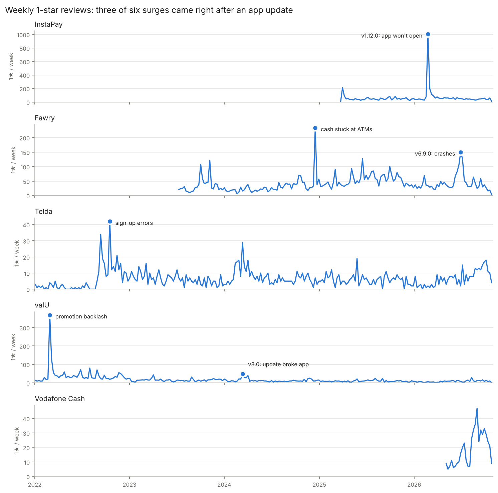
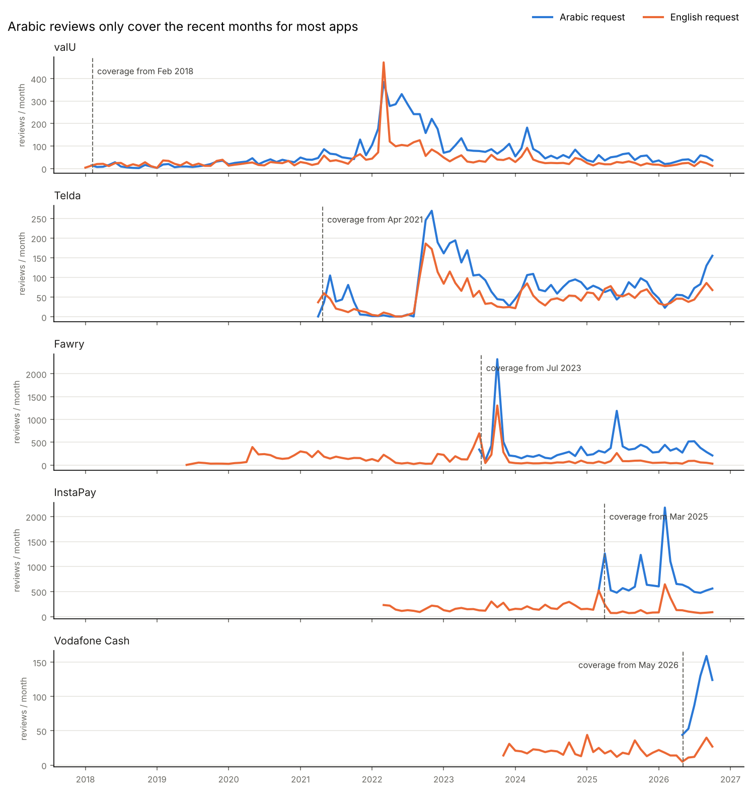

# Sawt El Omala (صوت العملاء)
### What Egyptian users really think about fintech apps

An analysis of real Google Play reviews of five Egyptian fintech apps: **InstaPay, Vodafone Cash, Telda, valU and Fawry**. The project finds what frustrates users most, when ratings dropped and why, and which app gives the best experience, across Arabic, English and Franco-Arabic reviews.

> Status: in progress. Data collected and cleaned (71,749 reviews); ratings-over-time analysis done; complaint topics next.

---

## Key findings
*(In progress: findings from the ratings analysis so far. Each app is measured over its full-coverage period; see `notebooks/02_ratings_over_time.ipynb`.)*

1. **Updates cause the worst weeks.** Three of six complaint surges came right after an update that stopped the app from opening: InstaPay 1.12.0, Fawry 6.9.0 and valU 8.0.x.
2. **InstaPay 1.12.0 (Feb 2026) is the biggest event in the data:** about 1,200 one-star reviews in two weeks, ~26x the usual level. That version averages 3.29★, down from 4.24★ for 1.11.0.
3. **Not every surge is technical.** Fawry's Dec 2024 surge is about cash stuck in ATM withdrawals with the Fawry card and no customer-service answer; valU's Feb 2022 surge is a reaction to a promotion and hidden fees.
4. **Rating prompts inflate averages.** Fawry's Sep–Oct 2023 wave added ~2,500 five-star reviews in five weeks, 72% of them one or two words.
5. **Reply speed varies widely.** Fawry answers 99% of negative reviews (median 5 hours); valU answers 88% but after a median of 46 days; Telda answers 19%.
6. **Top complaint:** _[topic]_ drives _[X]%_ of 1-star reviews across all apps. *(next: topic analysis)*



## Recommendations
*(2–3 per app, each tied to a number from the analysis.)*

| App | Biggest pain point | Recommendation |
| --- | --- | --- |
| InstaPay | | |
| Vodafone Cash | | |
| Telda | | |
| valU | | |
| Fawry | | |

---

## Business questions
1. What are the top complaint topics for each app, and what share of 1-star reviews does each topic cause?
2. When did ratings drop sharply, and does each drop line up with an app update, an outage or a policy change?
3. How does sentiment differ between Arabic, English and Franco-Arabic reviews?
4. Which app has the best overall experience, and what is each app's single biggest fix?

## Data
- **Source:** public Google Play reviews from the Egypt store, collected with [`google-play-scraper`](https://github.com/JoMingyu/google-play-scraper).
- **Collected on:** 28 October 2026
- **Size:** 71,762 raw reviews → 71,749 after cleaning (Fawry 26.6K, InstaPay 24.2K, valU 11.2K, Telda 8.4K, Vodafone Cash 1.3K)
- **Privacy:** user names and profile images are not stored.

| Column | Meaning |
| --- | --- |
| `reviewId` | unique review ID |
| `app` | app name |
| `lang_requested` | language requested from the store (`ar` / `en`); not reliable, the `en` results include many Arabic reviews |
| `lang_detected` | real language of the text: `arabic`, `english`, `franco` (Arabic in Latin letters) or `unknown` (emoji only) |
| `content` | review text |
| `score` | star rating, 1–5 |
| `thumbsUpCount` | how many users found the review helpful |
| `appVersion` | app version the reviewer used |
| `at` | review date |
| `replyContent`, `repliedAt` | company reply and its date |
| `collected_at` | when the review was scraped |

## Method
1. **Collection:** `src/collect_reviews.py` (newest reviews first, Arabic and English, Egypt store). Each review's real language is labeled by `src/language.py` with explainable rules (Arabic vs Latin letter count, Franco digit-letters like 3/7/2, and common Franco vs English words).
   Vodafone Cash has no separate app, so its reviews come from Ana Vodafone, filtered to those mentioning the wallet.
2. **Cleaning** (`src/cleaning.py`, `notebooks/01_cleaning.ipynb`): remove empty reviews, duplicate review IDs and keyboard-mash spam; re-detect language; normalize Arabic text; add date, coverage, star, reply and text-length columns. Repeated text is *not* treated as duplication ("ممتاز" alone is written 5,219 times by different people).
3. **Ratings over time** (`src/ratings.py`, `notebooks/02_ratings_over_time.ipynb`): monthly ratings for all reviews and for reviews with 3+ words; complaint surges = weeks with ≥40 one-star reviews and ≥3x the app's usual level (median of the previous 8 weeks), explained by reading the reviews and the app version; rating-prompt waves; ratings by app version; reply rate and speed.
4. **Complaint topics:** keyword dictionary in three languages, validated against 300 hand-labeled reviews (precision and recall per topic).
5. **Sentiment:** CAMeLBERT dialect model for Arabic, RoBERTa for English; mismatches between text and stars.
6. **Comparison:** app scorecard and dashboard.

## Repo structure
```
egypt-fintech-reviews/
├── config/
│   └── apps.json           # apps and their Play Store package IDs
├── src/
│   ├── collect_reviews.py  # scraper
│   ├── language.py         # arabic / english / franco detection
│   ├── cleaning.py         # cleaning pipeline
│   └── ratings.py          # monthly stats, surge detection, version stats
├── data/
│   ├── raw/                # scraped CSVs (not committed, re-create with the script)
│   └── processed/          # cleaning log, removed rows, language check sample
│                           # (reviews_clean.csv is re-created by src/cleaning.py)
├── notebooks/              # 01_cleaning, 02_ratings_over_time, ...
├── dashboard/              # Power BI file or Streamlit app
├── images/                 # charts used in this README
└── requirements.txt
```

## How to run
```bash
pip install -r requirements.txt

# 1. Find each app's package ID and paste it into config/apps.json
python src/collect_reviews.py --find-ids

# 2. Quick test with a small number of reviews
python src/collect_reviews.py --apps Telda --max 500

# 3. Full collection
python src/collect_reviews.py

# 4. Clean -> data/processed/reviews_clean.csv
python src/cleaning.py
```

## Limitations
- Play Store reviewers are not a random sample of users; unhappy users review more often.
- iOS App Store reviews are not included.
- Vodafone Cash reviews are a keyword-filtered subset of Ana Vodafone reviews, so wallet reviews that don't name the wallet are missed.
- Language rules can mislabel short or mixed Arabic/English reviews; a hand check of a random sample is reported in the cleaning notebook.
- **Uneven Arabic coverage:** the store returns the newest reviews up to a limit, and Arabic reviews hit it sooner. Arabic reviews start in Mar 2025 for InstaPay, Jul 2023 for Fawry and May 2026 for Vodafone Cash. Trends over time use only the period where both languages are collected (`in_full_coverage`).


- Keyword topic labels can miss sarcasm and mixed-language slang.
- No ready-made sentiment model exists for Franco-Arabic, so star ratings are used as its sentiment label.

## Tools
Python (pandas, scikit-learn, Hugging Face transformers), google-play-scraper, Power BI / Streamlit.
